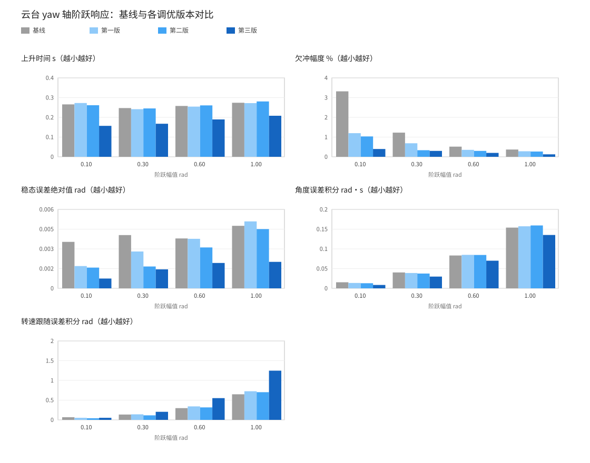
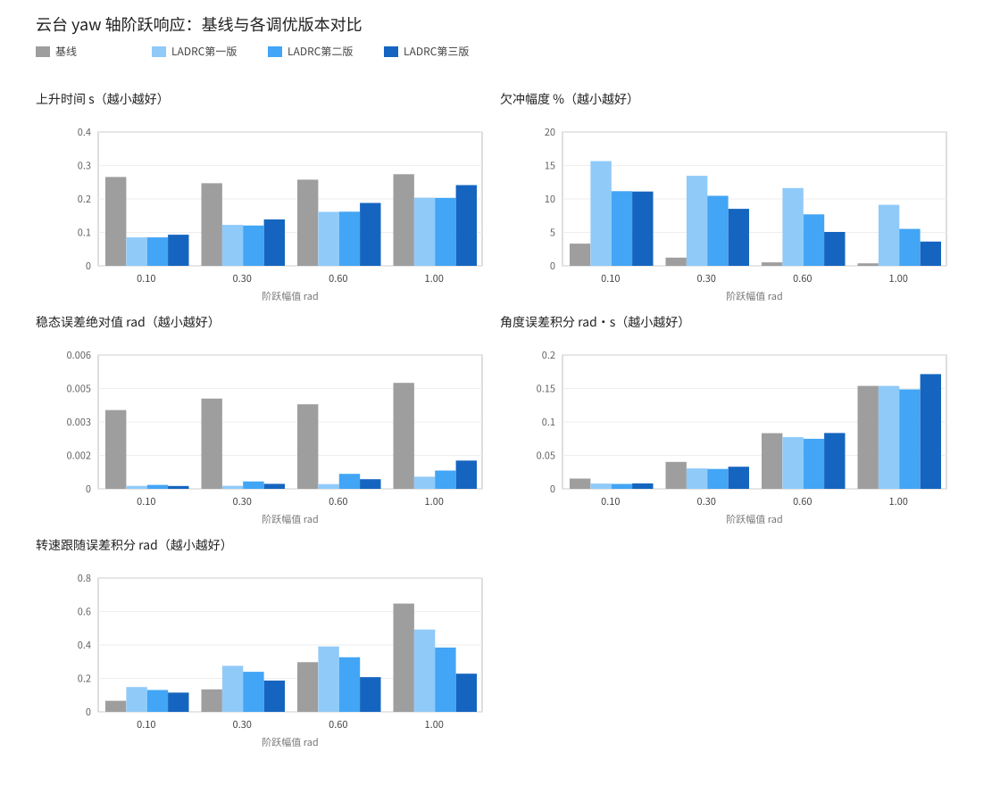
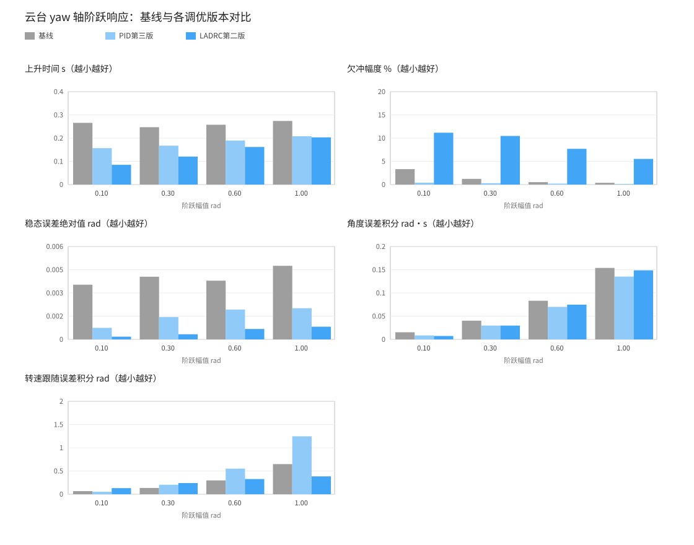

# 步兵云台 yaw 轴系统辨识与控制调优

任务编号 1.2。本文记录辨识与调优的做法，以及线下的操作步骤。

开发分支：辨识用 `dev/gimbal-yaw-sysid-data`，PID 调优用 `dev/gimbal-yaw-sysid-pid`，LADRC 用 `dev/gimbal-yaw-sysid-adrc`，基线为 `merge/deformable`。

## 一、目标与设备

目标是给步兵云台 yaw 轴建立至少二阶的数学模型，用实测数据确定模型参数，再依据模型调整控制器，最后对比调优前后的效果。

测试车是狗洞全向轮步兵 C 车，配置文件为 `deformable-infantry-omni-c.yaml`。

yaw 轴电机是 LK MG4010E-i10，型号里的 i10 表示减速比 10。该电机自带驱动，能通过 CAN 反馈角度、角速度和力矩。

## 二、建模

### 2.1 模型结构

取输入为电机力矩 \(T_e\)，输出为云台角度 \(\theta\)。忽略外部扰动时，转动方程为：

\[ J\ddot{\theta} = T_e - B\dot{\theta} \]

对应的传递函数是：

\[ \frac{\Theta(s)}{T_e(s)} = \frac{1}{Js^2 + Bs} \]

分母中 \(s\) 的最高次数是 2，所以这是二阶系统。两个极点分别在 \(s = 0\) 和 \(s = -\frac{B}{J}\)。

二阶的来源很清楚：力矩先决定角加速度，角加速度积分得到角速度，角速度再积分得到角度。最后一步积分决定了「力矩到角度」必须用二阶描述。

实际系统还有未建模因素：电流环带宽有限、CAN 通信与采样存在延时、减速机构有弹性、摩擦有非线性。这些因素会引入额外的时间常数，使真实系统高于二阶。

### 2.2 更完整的模型

战队现成的拟合脚本用的是灰箱模型，在二阶基础上补充了摩擦项：

\[ J\ddot{\theta} + B\dot{\theta} + F_c\tanh(k\dot{\theta}) = \tau \]

其中 \(J\) 是转动惯量，\(B\) 是粘性阻尼系数，\(F_c\) 是库仑摩擦幅值，\(k\) 是脚本内写死的平滑系数。

yaw 轴是竖直转轴，重力对该轴不产生力矩，所以脚本里的重力项对 yaw 不适用，拟合时要显式把它固定为 0。

### 2.3 前馈增益的物理含义

云台控制器里有两个前馈参数：`yaw_velocity_ff_gain` 和 `yaw_acceleration_ff_gain`。

按模型，让云台按期望轨迹运动所需的力矩是：

\[ \tau_{ff} = J\ddot{\theta}_{ref} + B\dot{\theta}_{ref} \]

所以加速度前馈增益的理想值就是辨识出的 \(J\)，速度前馈增益的理想值就是辨识出的 \(B\)。

现有 C 车配置里这两个值分别是 0.18 和 0.13。辨识结果可以和这两个数直接对照，用来判断现有前馈是否合理。

## 三、采集数据

### 3.1 复用工具

战队已有成套的辨识工具，直接复用：

| 工具                       | 位置                            | 作用                                               |
| -------------------------- | ------------------------------- | -------------------------------------------------- |
| `SweptFrequencyController` | `rmcs_core/src/identification/` | 产生扫频激励并把数据写成 CSV                       |
| `fit_sweep_graybox.py`     | `.script/identification/`       | 用扫频数据拟合灰箱模型，输出 \(J\)、\(B\)、\(F_c\) |

采集不需要自己写代码，只需要在配置里启用扫频组件。

### 3.2 配置改动

新增了辨识专用配置 `deformable-infantry-omni-c-sysid.yaml`，当前启用 6 个组件：

| 组件                                      | 用途                                        |
| ----------------------------------------- | ------------------------------------------- |
| `deformable_infantry`                     | 硬件                                        |
| `yaw_swept_frequency_controller`          | 被测轴的扫频与保持                          |
| `pitch_hold_controller`                   | 接管 pitch，只做位置保持                    |
| `referee_status`                          | 提供 `/referee/chassis/output_status`       |
| `chassis_controller`（DeformableChassis） | 提供 `/chassis/control_mode`                |
| `chassis_power_controller`                | 提供 `/chassis/supercap/charge_power_limit` |

其余组件全部停用：底盘的起立、轮子、关节、悬挂，射击系统，自瞄，以及各类 UI。目的是停用车辆底盘，只允许云台移动。

后三个是硬件命令组件里的超级电容的依赖要求，注释禁用会导致 RMCS 启动失败。

云台控制器必须停用：框架只允许一个组件注册同一路输出，它与扫频组件都要写 `/gimbal/yaw/control_torque`，同时启用会报重复输出并退出。停用后 pitch 由 `pitch_hold_controller` 接管，否则枪管会垂到底盘上。

### 3.3 扫频幅度

`amplitude` 直接决定数据能否使用，本次任务选取了 1.5 和 2.0（见 `五、拟合结果`）。判断依据是解环绕后的角度峰峰值，低频段应达到 10 度以上。幅度过小会让库仑摩擦在数据中占主导，拟合结果偏离线性模型。

### 3.4 角度保持

`SweptFrequencyController` 增加了 `setpoint_from_current` 参数：首次使能时把当前角度记为设定值，两个组件都启用它。

这样目标姿态由初始状态决定，不依赖电机零点是否准确。停机会清除记录，下次启动时重新取值。

### 3.5 操作步骤

在开发容器里执行：

```bash
build-rmcs                      # 构建
set-remote <remote-host>        # 首次连接 MiniPC 时才需要
sync-remote                     # 另开一个终端，保持运行，实时同步构建产物
```

同步终端出现 `Nothing to do` 后，进入部署容器：

```bash
ssh-remote
set-robot deformable-infantry-omni-c-sysid
service rmcs restart
service rmcs attach             # 查看实时输出，Ctrl+A 然后按 D 退出
```

若启动失败并提示 `Cannot find ... output`，说明某个组件的必需输入没有提供者。把报错里提到的组件注释掉；若缺失的信号是硬件命令组件需要的（超级电容相关），则反过来把提供它的组件启用。

### 3.6 录制
| 步骤 | 左开关 | 右开关 | 状态                               |
| ---- | ------ | ------ | ---------------------------------- |
| 1    | 下     | 下     | 停止出力                           |
| 2    | 中     | 下     | 使能，取当前角度为设定值，开始保持 |
| 3    | 中     | 中     | 继续保持                           |
| 4    | 中     | 上     | 触发扫频                           |
| 5    | 下     | 下     | 结束，云台失去力矩                 |

扫频满 60 秒自动结束并写入 csv 文件。日志里出现 `Started sweep logging to /tmp/...` 说明扫频确实开始了。

结束运行前必须先把两个开关拨到最下方，等电机停稳后再退出。
### 3.7 取回数据

CSV 写在部署容器的 `/tmp` 下，文件名形如 `swept_frequency_controller__gimbal_yaw_sweep_12345.csv`。

在开发容器里执行：

```bash
ssh-remote "ls -la /tmp/swept_frequency_controller_"*"_sweep_"*".csv"    # 先确认文件名
scp "remote:/tmp/<文件名>.csv" ./
```

## 四、拟合

### 4.1 确认依赖

```bash
python3 -c "import numpy; print(numpy.__version__)"
```

默认的线性模式只需要 numpy。若改用 `ode-angle` 模式，还需要 scipy。

### 4.2 执行拟合

```bash
python3 .script/identification/fit_sweep_graybox.py <csv 文件名> \
    --target /gimbal/yaw \
    --input-signal torque \
    --fixed-gravity-gain 0 \
    --fixed-gravity-phase 0 \
    --window-length 101
```

参数说明：

- `--target /gimbal/yaw`：脚本会去找 `/gimbal/yaw/control_torque`、`/gimbal/yaw/torque`、`/gimbal/yaw/velocity`、`/gimbal/yaw/angle` 这几列。
- `--input-signal torque`：用电机反馈的实际力矩作为输入。若反馈不可靠，改成 `control_torque`。
- `--fixed-gravity-gain 0 --fixed-gravity-phase 0`：yaw 轴没有重力矩，固定这两项，走三参数路径。这两项必须成对给出。
- `--window-length 101`：Savitzky-Golay 平滑窗口，这里以 101 为例。必须显式指定，报告结果时也要注明。（见 5.2 节）

脚本会输出 `Suggested params`，包含转动惯量、粘性阻尼、库仑摩擦，以及一组警告。要特别看 `Warnings` 段里有没有提到 \(R^2\) 过低、角度覆盖不足或优化器未收敛。

### 4.3 交叉验证

更改 amplitude 重新扫频，再拟合一次。若两次结果接近，说明模型可用。

## 五、拟合结果

采集得到的原始 CSV 数据位于 /data 文件夹下。

### 5.1 辨识结果

| 参数             | 第一次（amplitude 2.0） | 第二次（amplitude 1.5） | 采用值（平均） | 现有值 |
| ---------------- | ----------------------- | ----------------------- | -------------- | ------ |
| 转动惯量 \(J\)   | 0.128 kg·m²             | 0.120 kg·m²             | **0.124**      | 0.18   |
| 粘性阻尼 \(B\)   | 0.319 N·m·s/rad         | 0.450 N·m·s/rad         | **0.385**      | 0.13   |
| 库仑摩擦 \(F_c\) | 0.373 N·m               | 0.352 N·m               | **0.363**      | 无     |
| \(R^2\)          | 0.913                   | 0.863                   | —              | —      |

两组数据的平滑窗口同为 101。\(J\) 与 \(F_c\) 的差异在 6% 以内；\(B\) 单独看相差 41%，原因见下一节。采用两组平均值作为最终模型：

\[
0.124\,\ddot\theta + 0.385\,\dot\theta + 0.363\,\tanh(100\,\dot\theta) = \tau
\]

用指令力矩替代实测力矩再拟合一遍，第一组得到 \(J = 0.140\)、\(B = 0.387\)、\(F_c = 0.235\)（\(R^2 = 0.898\)），第二组得到 \(J = 0.138\)、\(B = 0.519\)、\(F_c = 0.252\)（\(R^2 = 0.847\)），与实测力矩的结果量级一致。


### 5.2 平滑窗口的敏感性

脚本默认的窗口长度是 31。加速度由角速度求导得到，窗口太短会放大噪声，导致拟合结果不准确。

第一组数据（amplitude 2.0）：

| 窗口长度    | \(J\) | \(B\) | \(F_c\) | \(R^2\) |
| ----------- | ----- | ----- | ------- | ------- |
| 31          | 0.096 | 0.411 | 0.306   | 0.748   |
| 51          | 0.119 | 0.385 | 0.325   | 0.874   |
| 101（采用） | 0.128 | 0.319 | 0.373   | 0.913   |
| 201         | 0.133 | 0.407 | 0.306   | 0.830   |

第二组数据（amplitude 1.5）：

| 窗口长度    | \(J\) | \(B\) | \(F_c\) | \(R^2\) |
| ----------- | ----- | ----- | ------- | ------- |
| 31          | 0.062 | 0.546 | 0.304   | 0.620   |
| 51          | 0.101 | 0.527 | 0.315   | 0.779   |
| 71          | 0.115 | 0.479 | 0.339   | 0.842   |
| 101（采用） | 0.120 | 0.450 | 0.352   | 0.863   |
| 151         | 0.125 | 0.430 | 0.361   | 0.855   |

交叉验证时两组必须用**同一个窗口**，否则会引入额外变量。

### 5.3 阻尼项的两组差异

\(B\) 与 \(F_c\) 在回归中相关：一组里 \(B\) 偏大时 \(F_c\) 就偏小，单独比较 \(B\) 意义有限。比较总阻尼力矩更合理：

\[
\tau_{damp}(\omega) = B\omega + F_c\tanh(100\omega)
\]

| 角速度    | amplitude 2.0 | amplitude 1.5 | 差异 |
| --------- | ------------- | ------------- | ---- |
| 0.5 rad/s | 0.533         | 0.577         | 8%   |
| 1.0 rad/s | 0.692         | 0.802         | 16%  |
| 2.0 rad/s | 1.011         | 1.252         | 24%  |

实测角速度峰值约 1 rad/s，在这个范围内两组总阻尼相差 8% 到 16%，可以接受；高速段差异变大，说明阻尼的非线性部分没有被模型完全覆盖。

### 5.4 与现有配置的对照

| 参数                       | 现有配置值 | 按辨识结果应为              |
| -------------------------- | ---------- | --------------------------- |
| `yaw_acceleration_ff_gain` | 0.18       | 约 0.124（即 \(J\)）        |
| `yaw_velocity_ff_gain`     | 0.13       | 约 0.385（即 \(B\)）        |
| `yaw_velocity_kp`          | 13.0       | 取 10 Hz 穿越频率时约 8.0   |
| `yaw_velocity_ki`          | 0.02       | 取 10 Hz 穿越频率时约 0.020 |

现有加速度前馈偏大约 40%，速度前馈偏小约 60%。速度环的 `ki` 与 10 Hz 穿越频率吻合，`kp` 折算约对应 16 Hz，两者不一致。

### 5.5 曲线

**待补充**。把拟合曲线截图放在 `docs/zh-cn/assets/` 下，用下面的方式插入：

```markdown

```

## 六、PID 调优

调优对象是日常配置里的 `gimbal_controller`，配置文件为 `deformable-infantry-omni-c.yaml`。

对比控制器效果时只允许云台运动，底盘、射击、自瞄与界面组件全部停用。

日常配置的 `pitch_motor_zero_point` 因 pitch 电机更换，改为 7093。

### 6.1 测试配置的改动

本轮调优直接在日常配置上改，改动如下：

| 项目       | 内容                                                                                                 |
| ---------- | ---------------------------------------------------------------------------------------------------- |
| 保留组件   | 硬件、云台控制器、裁判系统状态、底盘控制与底盘功率、采集组件                                         |
| 停用组件   | 射击、悬挂、轮子、关节、自瞄、界面。底盘控制与底盘功率两个组件只提供超级电容所需信号，不输出电机力矩 |
| pitch 零点 | `pitch_motor_zero_point` 改为 7093                                                                   |
| 采集       | 启用 `value_collector`，文件名设为 `yaw_<timestamp>.csv`                                             |
| 阶跃参数   | 新增 `yaw_step_test_enable`、`yaw_step_angles`、`yaw_step_hold`、`yaw_step_rest`，见 6.2             |

### 6.2 阶跃信号发生器

摇杆推满无法充当阶跃输入，原因有两条：

1. 摇杆量在控制器里被解释为目标角度的移动速率，推满只能让目标角度匀速变化，得到的是斜坡。
2. 摇杆推动过程需要 100 ms 以上，与云台 yaw 轴的响应时间同量级，会污染上升时间与超调。

因此在云台控制器内部自建发生器，把「摇杆量换算成目标角度」这一段替换为按时间自动给出目标角度的序列。遥控器仍然保留，只借用两个开关作为触发按钮。

目标角度属于云台控制器的内部状态，控制器没有对外提供写入目标角度的输入，所以发生器只能做在控制器内部。若改为新增组件，该组件能输出的只有摇杆量一类信号，只能产生匀速变化的目标角度；若让它直接写力矩指令，会与云台控制器争用同一路输出，并且绕开双环 PID，测到的只有被控对象。

改动内容：

| 项目   | 内容                                                                                                                                                |
| ------ | --------------------------------------------------------------------------------------------------------------------------------------------------- |
| 参数   | `yaw_step_test_enable` 默认关闭；`yaw_step_angles` 幅值表；`yaw_step_hold` 保持时长；`yaw_step_rest` 回原点停留时长；`yaw_step_repeat` 每档重复遍数 |
| 输入   | 新增一路可选输入，读取云台 yaw 当前角度                                                                                                             |
| 输出   | 新增目标转速输出；原本空置的目标角度输出在测试期间写入真实目标角                                                                                    |
| 兼容性 | 参数关闭时行为与改动前完全一致                                                                                                                      |

触发沿用扫频时的开关顺序：

| 步骤 | 左开关 | 右开关 | 行为                                   |
| ---- | ------ | ------ | -------------------------------------- |
| 1    | 下     | 下     | 停止出力                               |
| 2    | 中     | 下     | 使能，记录当前角度作为原点，pitch 保持 |
| 3    | 中     | 中     | 保持                                   |
| 4    | 中     | 上     | 触发，序列开始                         |
| 5    | 下     | 下     | 结束                                   |

左中右上这一组合与既有的悬挂切换（左下右上）不冲突。序列按幅值表依次执行：正向保持、回原点停留、反向保持、回原点停留，整轮流 `yaw_step_repeat` 遍。本次幅值取 0.1、0.3、0.6、1.0 rad，保持 2 s，间隔 1 s，每档正反各重复 2 遍，总时长 48 s。序列跑完或开关离开触发组合即停止。


测试期间摇杆不再控制 yaw 轴，pitch 仍受摇杆控制，操作时应避免触碰摇杆。

### 6.3 记录手段

采集以下七路信号：

| 信号                           | 含义                                                             |
| ------------------------------ | ---------------------------------------------------------------- |
| `/gimbal/yaw/angle`            | 实际角度，来自电机编码器                                         |
| `/gimbal/yaw/velocity`         | 实际角速度，来自电机反馈，云台相对底盘，已折算到输出端           |
| `/gimbal/yaw/velocity_imu`     | 实际角速度，自云台 IMU，云台相对地面，控制器速度环用的就是这一路 |
| `/gimbal/yaw/target_angle`     | 目标角度，仅用于采集，电机会忽略                                 |
| `/gimbal/yaw/target_velocity`  | 目标角速度，即角度环给出的转速指令，仅用于采集，电机会忽略       |
| `/gimbal/yaw/control_torque`   | 力矩指令                                                         |
| `/gimbal/yaw/torque`           | 实际力矩，来自电机反馈，用于判断是否进入饱和                     |

数据收集从 `service rmcs restart` 开始，非测试时段目标角度信号为空值，即 `nan`，这是正常现象，在数据分析阶段将非测试时段的数据剔除即可。

### 6.4 测量数据

切到日常配置：

```bash
ssh-remote
set-robot deformable-infantry-omni-c
service rmcs restart
service rmcs attach
```

**基线必须是能正常运行的状态**。若出厂参数本身就有异常（异响、顶限位），先把它修到能正常运行，以修好的状态为基线，并注明基线并非出厂值。基线状态异常时测出的数据不可信。

按 6.2 的开关顺序操作。第 4 步之后等待云台自动完成阶跃转动，随后把两个开关拨到最下，等电机停稳后退出。CSV 在部署容器的 `/tmp` 下，取回方式见 3.7。


### 6.5 调优方向

#### 6.5.1 PID 参数调整

遵循控制变量法，每次只改一类参数：

1. 先给速度环输出加限幅。基线数据显示力矩指令峰值达 130 N·m，而实测的电机输出上限约 11.3 N·m，各档阶跃都处于饱和。不限幅时改动其他参数只在饱和区打转。加限幅只需在配置里补 `yaw_velocity_output_min` 与 `yaw_velocity_output_max`，建议先取 ±10 N·m 使指令不越过实测上限，若要进一步抑制超调再往下试。
2. 再调速度环。速度环直接作用于被控对象，参数可以用模型算：目标穿越频率 \(f_c\) 下，\(k_p = 2\pi f_c J\)，\(k_i = 2\pi f_c B / 1000\)。除以 1000 是因为积分项按周期累加，运行周期是 1 ms。
3. 再调角度环。角度环的对象包含速度环和一个积分环节，增益过高会产生超调和振荡。
4. 若低速段有明显顿挫，说明库仑摩擦影响显著，需要在前馈里补一项与角速度方向有关的补偿。

目标穿越频率指开环增益降到 1 时的频率。频率低于它时环路增益大于 1，输出跟得上输入；频率高于它时跟不上。它给出了闭环能跟随的输入变化快慢的界限，取值越高响应越快，对噪声、通信延迟与力矩饱和也越敏感。取 10 Hz 时对应上升时间约 0.035 s。

前馈增益 `yaw_velocity_ff_gain` 与 `yaw_acceleration_ff_gain` 只在自瞄接管时参与运算，手动遥控与本次阶跃测试下不生效。5.4 节把这两个参数与辨识结果对照，得出的结论仅适用于自瞄工况。要在本轮对比中体现前馈效果，需要先把前馈接到手动与测试路径。

#### 6.5.2 考虑更改控制器

如果 PID 没有明显的优化空间，可以考虑使用其他控制器（如 ADRC，LADRC 等）。仓库内已有实现，位于 `rmcs_core/src/controller/adrc/`。

### 6.6 对比指标的定义

阶跃施加在目标角度上。角度环给出的目标转速随角度误差衰减，呈脉冲形态，上升时间与超调按角度曲线取才有意义。转速曲线用于考察跟踪过程的偏差。

| 指标             | 定义                                               | 从数据里怎么取                                          |
| ---------------- | -------------------------------------------------- | ------------------------------------------------------- |
| 上升时间         | 实际角度从阶跃开始到达目标行程 90% 的时间          | 找角度首次达到阶跃幅值 90% 的时刻                       |
| 超调量           | 实际角度超过目标的最大幅度，按阶跃幅值的百分比表示 | \((峰值 - 目标) / 幅值 \times 100\%\)                   |
| 稳态误差         | 保持段末实际角度与目标角度之差                     | 取保持段最后 1 秒的平均角度与目标相减                   |
| 角度误差积分     | 动态过程中角度误差对时间的积分                     | \(\int \lvert 目标角 - 实际角 \rvert dt\)               |
| 转速跟随误差积分 | 动态过程中目标转速与实际转速之差的积分             | \(\int \lvert 目标转速 - 实际转速 \rvert dt\)，越小表明跟随越紧。实际转速取自 IMU ，即速度环所用的反馈 |

前三项反映响应速度与阻尼，后两项反映跟随精度。大档位可能触及力矩上限，转速曲线呈先加速、中间匀速、再减速的梯形，属正常现象，记录时注明。


五项指标由 `.script/identification/analyze_step_response.py` 计算：

```bash
python3 .script/identification/analyze_step_response.py data/*.csv
```

脚本按目标角度的跳变点自动分段，每档每方向取 4 段（2 遍 × 正反各 2 次）的平均，同时给出峰值转速与峰值力矩。采样间隔由 `--dt` 指定，默认 5 ms。
### 6.7 基线测试结果

修复电机模式问题后重新采集，数据保存为 `data/yaw_baseline.csv`。每档取 4 段（2 遍，去程与回程各 2 次）的平均。此前采集的数据已作废并删除，原因见第七节。

| 档位 rad | 上升时间 s | 超调 % | 稳态误差 rad | 角度误差积分 rad·s | 转速误差积分 rad | 峰值转速 rad/s | 指令力矩 N·m | 实际力矩 N·m |
| -------- | ---------- | ------ | ------------ | ------------------ | ---------------- | -------------- | ------------ | ------------ |
| +0.10 | 0.275 | −4.5 | −0.0047 | 0.0170 | 0.081 | 0.994 | 13.0 | 10.37 |
| −0.10 | 0.256 | −2.2 | +0.0024 | 0.0138 | 0.051 | 1.028 | 12.8 | 10.53 |
| +0.30 | 0.250 | −1.4 | −0.0044 | 0.0405 | 0.135 | 2.605 | 39.1 | 11.14 |
| −0.30 | 0.244 | −1.1 | +0.0037 | 0.0400 | 0.134 | 2.603 | 38.9 | 11.25 |
| +0.60 | 0.259 | −0.6 | −0.0043 | 0.0839 | 0.300 | 4.677 | 78.1 | 11.28 |
| −0.60 | 0.256 | −0.4 | +0.0033 | 0.0826 | 0.294 | 4.702 | 78.0 | 11.28 |
| +1.00 | 0.275 | −0.4 | −0.0055 | 0.1564 | 0.669 | 6.927 | 130.2 | 11.29 |
| −1.00 | 0.273 | −0.3 | +0.0040 | 0.1515 | 0.625 | 6.971 | 129.7 | 11.25 |

**正负方向对称。** 同幅值下两个方向的上升时间、超调与稳态误差量级一致，符号相反。此前观察到的方向不对称由电机内部闭环造成，修复后消失。

**没有超调，表现为欠冲。** 超调量全为负，说明响应偏保守，阻尼偏大。

**稳态误差是约 0.005 rad 的固定静差，与幅值无关。** 这个量级对应摩擦死区，不是比例性误差。角度环积分增益为 0，速度环积分项的力矩上限为 \(0.02 \times 5.0 = 0.1\) N·m，小于辨识得到的库仑摩擦 0.363 N·m。

**力矩指令从最小档就饱和。** +0.1 档指令 13 N·m，实际输出 10.37 N·m；大档指令到 130 N·m，实际稳定在 11.3 N·m 附近。

### 6.8 调优第一版

只改速度环四项参数：`yaw_velocity_kp` 由 13.0 改为 7.8（按目标穿越频率 10 Hz 算得），`yaw_velocity_ki` 由 0.02 改为 0.024，输出限幅取 ±10 N·m，积分限幅取 ±20。角度环未动。

| 档位 rad | 上升时间 s | 超调 % | 稳态误差 rad | 转速误差积分 | 指令力矩 N·m | 实际力矩 N·m |
| -------- | ---------- | ------ | ------------ | ------------ | ------------ | ------------ |
| +0.10 | 0.286 | −2.1 | −0.0028 | 0.060 | 7.9 | 7.04 |
| −0.10 | 0.259 | −0.0 | +0.0005 | 0.042 | 7.7 | 7.04 |
| +0.30 | 0.244 | −1.0 | −0.0035 | 0.140 | 10.0 | 9.93 |
| −0.30 | 0.239 | −0.4 | +0.0021 | 0.139 | 10.0 | 9.97 |
| +0.60 | 0.258 | −0.6 | −0.0049 | 0.359 | 10.0 | 9.96 |
| −0.60 | 0.251 | −0.1 | +0.0026 | 0.325 | 10.0 | 9.99 |
| +1.00 | 0.274 | −0.4 | −0.0059 | 0.748 | 10.0 | 10.05 |
| −1.00 | 0.270 | −0.2 | +0.0043 | 0.703 | 10.0 | 10.00 |

**改善的**：欠冲减小，小档超调由 −4.5% 到 −2.1%，另一方向由 −2.2% 到 0；稳态误差约减半；力矩指令从 130 N·m 压到 10 N·m，不再深度饱和；小档转速跟随误差下降约 25%。

**变差的**：大档位转速跟随误差上升约 12%。比例增益从 13 降到 7.8，跟踪变慢，限幅又把力矩封在 10 N·m。

**基本未变**：上升时间，各档都在 0.24 到 0.29 s。

### 6.9 调优第二版

在第一版基础上只把 `yaw_velocity_kp` 由 7.8 提到 12.0（约 15 Hz），其余四项参数与角度环全部不动。数据保存为 `data/yaw_pid_v2.csv`。

| 档位 rad | 上升时间 s | 超调 % | 稳态误差 rad | 转速误差积分 |
| -------- | ---------- | ------ | ------------ | ------------ |
| +0.10    | 0.270      | −1.6   | −0.0021      | 0.046        |
| −0.10    | 0.253      | −0.5   | +0.0010      | 0.036        |
| +0.30    | 0.249      | −0.5   | −0.0022      | 0.121        |
| −0.30    | 0.241      | −0.1   | +0.0011      | 0.109        |
| +0.60    | 0.261      | −0.5   | −0.0039      | 0.326        |
| −0.60    | 0.260      | −0.1   | +0.0024      | 0.305        |
| +1.00    | 0.281      | −0.3   | −0.0051      | 0.709        |
| −1.00    | 0.280      | −0.2   | +0.0039      | 0.694        |

**全面优于第一版**：转速跟随误差小档降 23%，大档降 5%；稳态误差再降约 25%；欠冲进一步减小。相对基线，除上升时间持平外其余各项都改善。

**噪声没有随增益上升。** 保持段末 1 秒的 IMU 转速标准差：基线 0.0115，第一版 0.0112，第二版 0.0111 rad/s。比例增益从 7.8 提到 12，抖动没有变大，说明离噪声限制还远。

**稳态误差与摩擦死区的理论值吻合。** 死区约为 \(F_c / (k_{p,a} \times k_{p,v}) = 0.363 / (10 \times 12) \approx 0.003\) rad，实测 0.002 到 0.005 rad。

### 6.10 调优第三版

在第二版基础上只把 `yaw_angle_kp` 由 10.0 提到 15.0，速度环不动。数据保存为 `data/yaw_pid_v3.csv`。

| 档位 rad | 上升时间 s | 超调 % | 稳态误差 rad | 角度误差积分 rad·s | 转速误差积分 rad | 峰值转速 rad/s |
| -------- | ---------- | ------ | ------------ | ------------------ | ---------------- | -------------- |
| +0.10    | 0.158      | −0.4   | −0.0009      | 0.0089             | 0.054            | 1.354          |
| −0.10    | 0.156      | −0.1   | +0.0005      | 0.0082             | 0.050            | 1.284          |
| +0.30    | 0.169      | −0.3   | −0.0016      | 0.0298             | 0.202            | 3.348          |
| −0.30    | 0.166      | −0.3   | +0.0013      | 0.0297             | 0.207            | 3.377          |
| +0.60    | 0.190      | −0.3   | −0.0024      | 0.0707             | 0.556            | 5.632          |
| −0.60    | 0.189      | −0.1   | +0.0015      | 0.0693             | 0.544            | 5.652          |
| +1.00    | 0.210      | −0.2   | −0.0024      | 0.1375             | 1.268            | 8.000          |
| −1.00    | 0.206      | −0.1   | +0.0016      | 0.1329             | 1.225            | 8.095          |

**上升时间大幅缩短。** 由第二版的 0.24 到 0.28 s 降到 0.16 到 0.21 s，这是前三版唯一没有改善的指标。

**角度精度全面改善。** 超调量接近 0（−0.1% 到 −0.4%），稳态误差降到 0.0005 到 0.0024 rad，比第二版再降约 60%。角度误差积分小档降约 36%，大档降约 14%。

**转速跟随误差明显变差。** 大档由 0.709 升到 1.268，升幅约 79%。原因是角度环增益提高后，角度环给出的目标转速超出电机能力：峰值目标转速由 6.8 升到 8.1 rad/s，而力矩被限幅在 10 N·m，实际跟不上。这是指令超出物理能力的表现，属于指标定义的副作用，不代表跟随能力退化。


### 6.11 各版参数对照

| 参数 | 基线 | 第一版 | 第二版 | 第三版 |
| ---- | ---- | ------ | ------ | ------ |
| `yaw_angle_kp` | 10.0 | 10.0 | 10.0 | 15.0 |
| `yaw_angle_ki` | 0.0 | 0.0 | 0.0 | 0.0 |
| `yaw_velocity_kp` | 13.0 | 7.8 | 12.0 | 12.0 |
| `yaw_velocity_ki` | 0.02 | 0.024 | 0.024 | 0.024 |
| `yaw_velocity_output_min/max` | 无穷大 | ±10 | ±10 | ±10 |
| `yaw_velocity_integral_min/max` | ±5 | ±20 | ±20 | ±20 |


### 6.12 对比图

五个指标各占一个面板，面板内按阶跃幅值分组，每个幅值四根柱对应基线与三个调优版本。正负方向取绝对值后平均，柱越低越好。



图由 `.script/identification/plot_tuning_comparison.py` 生成，输出为 SVG，不依赖绘图库：

```bash
python3 .script/identification/plot_tuning_comparison.py \
    -o docs/zh-cn/assets/yaw-tuning-comparison.svg \
    基线=data/yaw_baseline.csv \
    第一版=data/yaw_pid_v1.csv \
    第二版=data/yaw_pid_v2.csv \
    第三版=data/yaw_pid_v3.csv
```

## 七、LADRC

### 7.1 方案与整定

PID 第三版把上升时间压到 0.16 到 0.21 s、稳态误差压到 0.002 rad 量级。继续提高角度环增益只会让目标转速进一步超出电机能力（见 6.10 节），改用 LADRC，把摩擦与未建模动态交给扩张状态观测器估计并补偿。

实现复用 `rmcs_core/src/controller/adrc/` 下的跟踪微分器、扩张状态观测器与误差反馈律，在云台控制器内部加一条分支，由 `yaw_adrc_enable` 打开。误差反馈用的非线性函数指数取 1，反馈律退化为线性，即 LADRC。

整定只剩三个量：

| 参数              | 取值       | 依据                                                                    |
| ----------------- | ---------- | ----------------------------------------------------------------------- |
| \(b_0\)           | 8.06       | \(1/J\)，\(J\) 取辨识值 0.124                                           |
| \(k_1\)           | 625        | \(\omega_c^2\)，\(\omega_c = 25\) rad/s                                 |
| \(k_2\)           | 60         | \(2\zeta\omega_c\)，\(\zeta = 1.2\)                                     |
| \(w_0\)           | 75         | \(3\omega_c\)                                                           |
| `yaw_adrc_td_r`   | 60         | 安排轨迹的加速度上限，按 \(\tau_{max}/J = 10/0.124 \approx 80\) 留摩擦余量 |
| `yaw_adrc_output_min/max` | ±10 | 与实测电机上限 11.3 N·m 对应                                       |

表中是第一版取值，第二版把 \(k_2\) 提到 75（见 7.3）。

LADRC 直接对角度运算并输出力矩。编码器角度在 0 与 \(2\pi\) 处回绕会让跟踪微分器看到 \(2\pi\) 的跳变，控制器内部维护一路连续角度，供观测器与跟踪微分器使用。

### 7.2 第一版结果

数据保存为 `data/yaw_ladrc_v1.csv`。指令力矩峰值 10.0 N·m，说明输出限幅生效，测试确实走了 LADRC 分支。

| 档位 rad | 上升时间 s | 超调 % | 稳态误差 rad | 角度误差积分 rad·s | 转速误差积分 rad | 峰值转速 rad/s | 指令力矩 N·m | 实际力矩 N·m |
| -------- | ---------- | ------ | ------------ | ------------------ | ---------------- | -------------- | ------------ | ------------ |
| +0.10    | 0.086      | 16.1   | +0.00004     | 0.0079             | 0.149            | 2.002          | 9.3          | 8.87         |
| −0.10    | 0.084      | 15.3   | −0.00018     | 0.0077             | 0.148            | 1.979          | 9.3          | 8.85         |
| +0.30    | 0.122      | 13.1   | −0.00001     | 0.0305             | 0.273            | 4.165          | 10.0         | 9.92         |
| −0.30    | 0.122      | 13.8   | −0.00023     | 0.0305             | 0.278            | 4.152          | 10.0         | 9.83         |
| +0.60    | 0.161      | 11.3   | −0.00008     | 0.0770             | 0.390            | 6.131          | 10.0         | 10.01        |
| −0.60    | 0.161      | 12.0   | −0.00034     | 0.0775             | 0.391            | 6.221          | 10.0         | 9.93         |
| +1.00    | 0.204      | 8.9    | +0.00017     | 0.1534             | 0.494            | 8.079          | 10.0         | 9.98         |
| −1.00    | 0.204      | 9.3    | −0.00060     | 0.1544             | 0.490            | 8.086          | 10.0         | 9.94         |

**上升时间大幅缩短。** 0.1 档由基线的 0.275 s 降到 0.086 s，比 PID 第三版的 0.158 s 快约一倍。1.0 档 0.204 s，与第三版的 0.210 s 接近，该档已接近力矩限幅下的物理极限。

**稳态误差基本消除。** 各档稳态误差在 \(10^{-4}\) rad 量级，比 PID 第三版小一个数量级。观测器估计出的总扰动包含库仑摩擦，控制律里直接补偿，不需要靠积分项去顶死区。

**出现 8.9% 到 16.1% 的超调。** 基线与三版 PID 都表现为欠冲，超调是本次新出现的现象，\(\zeta = 1.2\) 的二阶系统理论上不过冲。小档超调更大，且 0.1 档力矩 9.3 N·m 未到限幅，排除饱和因素。

**稳态没有抖振。** 取 2 s 保持段末 1 秒统计，IMU 转速标准差 0.0109 rad/s（基线 0.0115，PID 第三版 0.0111），力矩标准差 0.019 N·m（基线 0.151，PID 第三版 0.134）。力矩抖动降到七分之一，说明扰动估计准确，稳态几乎不需要出力调整。

**转速误差积分与 PID 不同源。** PID 记录的是角度环输出，LADRC 记录的是跟踪微分器安排的轨迹速度。0.1 档 0.149 偏高，来自安排轨迹的峰值速度 2.45 rad/s 高于实际达到的 2.0 rad/s，属于安排轨迹超出跟踪能力。

### 7.3 第二版结果

超调最可能来自观测器滞后。\(w_0 = 75\) 的时间常数约 13 ms，0.1 档整个上升过程只有 86 ms，速度估计落后于实际转速，制动指令发出时已经晚了。幅值越小、过程越短，滞后占比越大，与「小档超调更大」吻合。

第二版先试着把 \(w_0\) 提到 150。运行周期 1 ms 下离散特征值 \(1 - h w_0 = 0.85\) 仍在单位圆内，但上电后 yaw 轴立即剧烈震颤，测试中止。观测器三项增益按 \(3w_0\)、\(3w_0^2\)、\(w_0^3\) 生成，\(w_0\) 翻倍使 \(\beta_2\) 涨 4 倍、\(\beta_3\) 涨 8 倍，\(z_3\) 的单步更新量 \(h\beta_3 e\) 达到 \(3375\,e\)，编码器噪声足以淹没扰动估计；同时 24 Hz 已靠近电流环与通信延时起作用的频段。带宽上限受反馈噪声限制，这台车在 1 ms 周期下的可用值在 75 到 150 之间。

第二版改为提高反馈律阻尼，把 \(k_2\) 由 60 提到 75（\(\zeta\) 由 1.2 提到 1.5），\(w_0\) 保持 75。数据保存为 `data/yaw_ladrc_v2.csv`。

| 档位 rad | 上升时间 s | 超调 % | 稳态误差 rad | 角度误差积分 rad·s | 转速误差积分 rad | 峰值转速 rad/s | 指令力矩 N·m | 实际力矩 N·m |
| -------- | ---------- | ------ | ------------ | ------------------ | ---------------- | -------------- | ------------ | ------------ |
| +0.10    | 0.085      | 10.6   | +0.00023     | 0.0075             | 0.130            | 1.981          | 9.6          | 9.45         |
| −0.10    | 0.085      | 11.7   | −0.00011     | 0.0073             | 0.131            | 2.027          | 9.6          | 9.44         |
| +0.30    | 0.121      | 10.2   | +0.00052     | 0.0297             | 0.240            | 4.137          | 10.0         | 9.91         |
| −0.30    | 0.120      | 10.7   | +0.00014     | 0.0298             | 0.239            | 4.145          | 10.0         | 9.93         |
| +0.60    | 0.161      | 7.4    | +0.00065     | 0.0748             | 0.328            | 6.060          | 10.0         | 10.00        |
| −0.60    | 0.163      | 8.0    | −0.00016     | 0.0748             | 0.324            | 6.092          | 10.0         | 9.99         |
| +1.00    | 0.205      | 5.1    | +0.00112     | 0.1499             | 0.390            | 7.932          | 10.0         | 10.04        |
| −1.00    | 0.201      | 5.9    | −0.00046     | 0.1475             | 0.378            | 7.973          | 10.0         | 9.98         |

**超调降到 5.1% 到 11.7%。** 比第一版降三分之一到一半，上升时间没有变化（0.085 s 与 0.205 s）。角度误差积分各档都略优于第一版。

**抖振没有变差。** IMU 转速标准差 0.0109 rad/s，力矩标准差 0.025 N·m，与第一版的 0.019 N·m 同量级。

**稳态误差变差一档。** 由 \(10^{-4}\) 升到 \(10^{-3}\) 量级，1.0 档 0.00112 rad。原因是 \(k_2\) 提高后阻尼项在稳态附近仍有输出，与扰动补偿项相抵。该值仍比 PID 第三版的 0.0024 rad 小一半。

**超调随幅值的规律没有变。** 小档 10.6%，大档 5.1%，说明 \(w_0\) 仍是限制因素，只是这台车不能用提高带宽的办法解决。

### 7.4 第三版结果

改安排轨迹，把 `yaw_adrc_td_r` 由 60 降到 40。安排轨迹的峰值速度是 \(\sqrt{Ar}\)，0.1 档由 2.45 降到 2.0 rad/s，与第二版实际达到的 1.98 rad/s 吻合。数据保存为 `data/yaw_ladrc_v3.csv`。

| 档位 rad | 上升时间 s | 超调 % | 稳态误差 rad | 角度误差积分 rad·s | 转速误差积分 rad | 峰值转速 rad/s | 指令力矩 N·m | 实际力矩 N·m |
| -------- | ---------- | ------ | ------------ | ------------------ | ---------------- | -------------- | ------------ | ------------ |
| +0.10    | 0.092      | 10.6   | +0.00015     | 0.0080             | 0.114            | 1.780          | 7.3          | 7.17         |
| −0.10    | 0.094      | 11.6   | −0.00003     | 0.0084             | 0.117            | 1.815          | 7.4          | 7.19         |
| +0.30    | 0.140      | 8.5    | +0.00026     | 0.0333             | 0.189            | 3.603          | 8.2          | 8.06         |
| −0.30    | 0.138      | 8.6    | +0.00005     | 0.0327             | 0.185            | 3.584          | 8.0          | 7.73         |
| +0.60    | 0.189      | 5.1    | +0.00054     | 0.0840             | 0.210            | 5.160          | 8.1          | 7.90         |
| −0.60    | 0.188      | 5.1    | −0.00018     | 0.0830             | 0.204            | 5.128          | 8.0          | 7.81         |
| +1.00    | 0.241      | 3.6    | +0.00121     | 0.1715             | 0.229            | 6.539          | 8.2          | 7.97         |
| −1.00    | 0.241      | 3.6    | −0.00089     | 0.1713             | 0.227            | 6.521          | 8.0          | 7.99         |

**转速跟随误差大幅下降。** 1.0 档由 0.390 降到 0.229，降 41%；0.6 档降 36%。安排轨迹的峰值速度与实际能达到的速度对上了。

**大档超调继续下降。** 1.0 档 5.1% 到 3.6%，0.6 档 7.4% 到 5.1%。

**力矩退出饱和。** 指令峰值由 10.0 降到 8.2 N·m，对电机实测上限 11.3 N·m 留出约 20% 余量。

**上升时间变差。** 0.1 档由 0.085 到 0.092 s，1.0 档由 0.205 到 0.241 s。

**角度误差积分变差，1.0 档已不如基线。** 0.1 档由 0.0075 到 0.0080，1.0 档由 0.1499 到 0.1715。基线 1.0 档是 0.1564，第三版在这一档比基线还差。原因是安排轨迹过慢，目标角度变化慢而实际角度的滞后累积更久。

**小档超调没有改善。** 0.1 档三版分别是 16.1%、10.6%、10.6%。`td_r` 由 60 降到 40 对它没有影响，说明成因不在安排轨迹，而在低速段摩擦的强非线性：行程小、速度低时库仑摩擦占比高，速度过零时补偿量需要重建，观测器时间常数 13 ms 在这个尺度下仍是主要限制。

**稳态力矩抖动变差。** 标准差由 0.025 升到 0.054 N·m，仍优于 PID 第三版的 0.134。

### 7.5 三版对比图

五个指标各占一个面板，面板内按阶跃幅值分组，每个幅值四根柱对应基线与三个 LADRC 版本。正负方向取绝对值后平均，柱越低越好。



图由 `.script/identification/plot_tuning_comparison.py` 生成：

```bash
python3 .script/identification/plot_tuning_comparison.py \
    -o docs/zh-cn/assets/yaw-ladrc-comparison.svg \
    基线=data/yaw_baseline.csv \
    LADRC第一版=data/yaw_ladrc_v1.csv \
    LADRC第二版=data/yaw_ladrc_v2.csv \
    LADRC第三版=data/yaw_ladrc_v3.csv
```

### 7.6 版本选择

按实际工况排优先级，评判标准依次是：

1. **角度误差积分。** 全过程跟踪精度，同时包含响应速度与超调的贡献，自瞄跟踪时的主要指标。
2. **上升时间。** 决定跟踪滞后，目标机动时直接表现为脱靶量。
3. **稳态误差。** 决定锁定后的静态偏差。
4. **力矩标准差。** 抖振程度，影响电机发热与机械磨损。
5. **力矩峰值余量。** 留出多少能力应对外部扰动。

**PID 取第三版。** 它的上升时间 0.158 到 0.210 s、稳态误差 0.0009 到 0.0024 rad、角度误差积分 0.0089 到 0.1375 rad·s，三项都是三版 PID 里最好的，第二版只在转速跟随误差上接近它。

**LADRC 取第二版。** 第二版与第三版的取舍如下：

| 指标 | 第二版 | 第三版 | 占优 |
| ---- | ------ | ------ | ---- |
| 角度误差积分 0.1 档 | 0.0075 | 0.0080 | 第二版 |
| 角度误差积分 1.0 档 | 0.1499 | 0.1715 | 第二版 |
| 上升时间 0.1 档 | 0.085 | 0.092 | 第二版 |
| 上升时间 1.0 档 | 0.205 | 0.241 | 第二版 |
| 力矩标准差 | 0.025 | 0.054 | 第二版 |
| 转速误差积分 1.0 档 | 0.390 | 0.229 | 第三版 |
| 超调 1.0 档 | 5.1 | 3.6 | 第三版 |
| 力矩峰值余量 | 无 | 约 20% | 第三版 |

第二版在角度误差积分、上升时间、力矩标准差三项上占优，第三版在转速跟随误差、大档超调、力矩余量三项上占优。按上面的优先级，角度误差积分与上升时间排在前两位，第二版胜出。

关键的取舍在 1.0 档：第三版的角度误差积分 0.1715 已经不如基线的 0.1564，第二版的 0.1499 仍优于基线。另外，超调在实际工况中的影响有限，云台不是精密定位机构，10% 过冲在自瞄持续跟踪的过程中不累积为脱靶量；上升时间则直接决定跟踪滞后。

最终选定的 LADRC 参数为 `yaw_adrc_td_r` 60、`yaw_adrc_k2` 75、`yaw_adrc_eso_w0` 75、`yaw_adrc_b0` 8.06、`yaw_adrc_k1` 625、输出限幅 ±10 N·m。

### 7.7 与 PID 第三版的最终对比

| 指标 | 基线 | PID 第三版 | LADRC 第二版 |
| ---- | ---- | ---------- | ------------ |
| 上升时间 +0.10 s | 0.275 | 0.158 | **0.085** |
| 上升时间 +1.00 s | 0.275 | **0.210** | 0.205 |
| 超调 +0.10 % | −4.5 | −0.4 | +10.6 |
| 超调 +1.00 % | −0.4 | −0.2 | +5.1 |
| 稳态误差 +0.10 rad | −0.0047 | −0.0009 | **+0.00023** |
| 稳态误差 +1.00 rad | −0.0055 | −0.0024 | **+0.00112** |
| 角度误差积分 +0.10 rad·s | 0.0170 | 0.0089 | **0.0075** |
| 角度误差积分 +1.00 rad·s | 0.1564 | **0.1375** | 0.1499 |
| 力矩标准差 N·m | 0.151 | 0.134 | **0.025** |



```bash
python3 .script/identification/plot_tuning_comparison.py \
    -o docs/zh-cn/assets/yaw-final-comparison.svg \
    基线=data/yaw_baseline.csv \
    PID第三版=data/yaw_pid_v3.csv \
    LADRC第二版=data/yaw_ladrc_v2.csv
```

**LADRC 第二版相对 PID 第三版的优势在中小幅值。** 0.1 档上升时间快 46%（0.085 对 0.158 s），稳态误差小到四分之一，角度误差积分小 16%，稳态力矩抖动只有五分之一。云台在日常跟踪中输入以中小幅值为主，这几项直接对应跟得上、锁得准、不发热。

**1.0 档两者互有胜负。** 上升时间基本持平（0.205 对 0.210 s），角度误差积分 PID 第三版更好（0.1375 对 0.1499）。该档已接近限幅下的物理极限，两种控制器都受电机能力约束。

**LADRC 的代价是超调。** 基线与三版 PID 都欠冲，LADRC 出现过冲 5.1% 到 11.6%。成因是观测器带宽受反馈噪声限制，无法再提高（见 7.3）。若后续要消除它，方向是补一条摩擦前馈，让观测器不必在每次速度过零时重建补偿量。

## 八、过程中遇到的问题

- 扫频组件与云台控制器争用同一路输出，辨识时必须停用云台控制器。
- 扩张状态观测器的带宽不能只按离散特征值判据选。\(w_0\) 由 75 提到 150 时 \(1 - h w_0 = 0.85\) 仍在单位圆内，上电后 yaw 轴却立即剧烈震颤。三项增益按 \(w_0\)、\(w_0^2\)、\(w_0^3\) 增长，反馈噪声与未建模延时共同决定了带宽上限，这台车在 1 ms 周期下的可用值在 75 到 150 之间。
- 这台车上有两个 pitch：云台 pitch 控制枪管俯仰，底盘 pitch（`active_suspension_pitch_*`）属于底盘主动悬挂，控制车身起立姿态。讨论前先分清是哪个。
- 保持器的 `position_ki` 非零会把轴推过目标并顶住机械限位，`position_kp` 过大会持续抖振并发出响声。响声来自 `velocity_kp` 放大速度反馈噪声，与 `position_kp` 无关。
- 电机零点不准时 `setpoint: 0.0` 对应的机械位置不可预期。用 `setpoint_from_current` 让目标取当前角度可以绕开。
- `value_collector` 只接受标量信号，摇杆量是二维向量，无法直接记录。阶跃测试改用发生器给定目标，绕开了记录摇杆量的需要。
- 电机消费四路控制指令：`control_torque`、`control_velocity`、`control_angle`、`control_angle_shift`。仅供采集的信号必须避开这四个名字，因此目标角度与目标转速改名为 `/gimbal/yaw/target_angle` 与 `/gimbal/yaw/target_velocity`。这两路原先从未赋值，采到的全是空值，本次改动在测试期间补上了赋值。
- 云台加速时的反作用力矩会让车身反向摆动，IMU 的 yaw 角速度包含这一分量。跟随误差按 IMU 那一路计算，电机那一路用于估计车身晃动。
- 速度环输出没有限幅，误差乘比例系数后直接下发，峰值可达电机上限的二十倍以上。表现为深度饱和、超调与振荡。调优前先加输出限幅。
